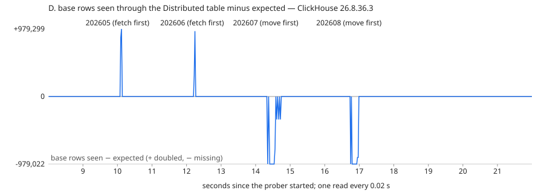

# Resharding a self-managed ClickHouse cluster: 2 → 3 shards

[English](#english) | [한국어](#한국어)

---

## English

ClickHouse OSS does not rebalance shards. The "Rebalancing Data" guide says so in its first sentence and lists four
manual ways, in order of preference (read 2026-11-07 at ClickHouse/ClickHouse `e73957f`,
`docs/guides/oss/deployment-and-scaling/scaling-clusters.mdx`). This lab runs them on a local cluster — ClickHouse
Keeper, two shards of two replicas, then a third shard — and measures each one: rows per shard before and after,
how long it took, what a background reader and writer saw during the move, and a per-partition check of what was
copied. One failure case kills a source replica in the middle of a copy.

**Verified on ClickHouse 26.8.36.3 (LTS), 2026-11-07** — one end-to-end `run.py all` started 13:44 KST, server and Keeper
from the `clickhouse/clickhouse-server:26.8.36.3` image, Docker Desktop VM with 12 CPUs and 7.7 GiB, no other containers
running. Nothing here has been run on another version. Earlier runs the same day are in
[`results/earlier-runs/`](results/earlier-runs/).

| Option | What moves | Run here |
|---|---|---|
| A. New shard + `<weight>` | nothing; new writes are biased to the new shard | yes |
| B. `INSERT … SELECT` from `remote()` into a new 3-shard layout | every row, re-hashed | yes (`remote`, not `remoteSecure`) |
| C. `clickhouse-copier` | every row | **no** — moved out of the bundle in 24.3, "no longer supported" (see below) |
| D. `FETCH PARTITION` + `ATTACH` + `DROP` (and `MOVE PARTITION TO TABLE` as a staging step) | whole partitions | yes |

### Run it

Needs Docker (about 3–4 GB free for the seven containers) and Python 3; no Python packages.

```bash
cd workload/resharding
python3 run.py up          # Keeper + 6 servers; HTTP on 127.0.0.1:18201-18206
python3 run.py all         # selftest, A, D, failure, B -> results/<version>.json and .log (about 17 min, 6 of them waiting on timeouts)
python3 report.py          # RESULTS.md and images/d-reads-<version>.svg from the JSON
python3 run.py down        # removes containers and volumes
```

`python3 run.py a` (or `b`, `d`, `fail`, `selftest`) runs one option from a fresh 2-shard state and writes
`results/<version>-<option>.json`; `python3 run.py resume b d` runs steps into the existing `results/<version>.json`.
`ROWS=600000 python3 run.py all` is a quick pass. `CH_IMAGE=…` picks another image for `up`.

### Set-up

- `docker-compose.yml`: `keeper` (single node, 512 MiB) and `ch-s{1,2,3}r{1,2}`, each capped at 2 CPUs and 900 MiB
  (`ch-s1r1`, which runs every copy and the prober, 1,400 MiB). The six
  servers share `conf.d/` and `users.d/`; `{shard}` and `{replica}` come from the container environment
  (`<shard from_env="SHARD"/>`).
- `conf.d/clusters.xml` is written by `run.py` (not tracked). Cluster `old` starts as shards 1–2; cluster `new3` is
  shards 1–3. Every option starts from the same state: database `rs`, 12,000,000 rows from 2026-05-01 to 2026-11-07
  (7 monthly partitions), `ReplicatedMergeTree` partitioned by `toYYYYMM(ts)`, `Distributed(old, rs, events_local, cityHash64(user_id))`.
- In B the "new cluster" is database `rs_new` on the same six servers (`Distributed(new3, …)`). A real new cluster
  has its own disks and network; here the copy competes with the source for the same CPUs and disks.
- **Prober** (`Prober` in `run.py`): a reader runs `SELECT count()` of the base rows through the Distributed table
  every 0.2 s (every 0.02 s in D), and a writer inserts 50 rows every 0.25 s with `distributed_foreground_insert = 1`.
  Both go to `ch-s1r1`. A read is "doubled" or "missing" when its count differs from the snapshot.
- **Check** (`check` in `run.py`): per partition `count()`, `uniqExact(event_id)` and
  `sum(cityHash64(<all columns>))` of the base rows against the snapshot taken before the move, after
  `SYSTEM SYNC REPLICA` on every replica; plus every acknowledged probe row present exactly once. The selftest
  proves it fires: one row inserted twice, then deleted, then one value changed with the count unchanged.

### Results

Full tables: [RESULTS.md](RESULTS.md). Rows per shard (shard 1 / 2 / 3, local `count()` on the first replica, including the
prober's rows):

| Option | Before | After | Took | Check |
|---|---|---|---|---|
| A. weights 1:1:2 + 3,000,000 new rows | 6,002,487 / 5,997,513 / 0 | 6,755,667 / 6,745,787 / 1,500,946 | config picked up in 0.92–1.14 s | PASS |
| B. `remote()` copy, 6 partitions online + hot partition in a write freeze | 6,002,487 / 5,997,513 / 0 | 4,017,368 / 3,973,248 / 4,014,084 | 2.6 s bulk, 0.31 s write freeze | PASS |
| D. 2 partitions from each old shard to shard 3 | 6,002,487 / 5,997,513 / 0 | 4,077,796 / 4,041,946 / 3,884,658 | 0.10–0.30 s per partition | PASS |

- **A.** Rewriting `clusters.xml` on the host was enough; every server showed shard 3 after 0.92–1.14 s without
  `SYSTEM RELOAD CONFIG` (earlier runs: 0.92–1.15 s, 1.57–2.00 s). The 3,000,000 new rows went 751,983 / 747,167 /
  1,500,850; the old rows did not move. Point lookups with `optimize_skip_unused_shards = 1` went wrong: 97 of 200 users
  got fewer rows than without it (5,849 rows not returned), because the sharding expression now sends half of the users
  to a shard that does not hold their old rows. Before the change, 0 of 200 differed.
- **B.** Each partition of about 1.9 million rows copied in 0.40–0.55 s. The check before the cut-over failed as it
  should: the hot partition (202611) was not there yet and none of the 2,700 rows the writer had acknowledged during
  the copy were in the new table. Freezing writes, copying 202611 (378,947 rows + probe rows) and switching took
  0.31 s; then the check passed, the replicas of each shard agreed, and point lookups with
  `optimize_skip_unused_shards = 1` were right for 200 of 200 users. The reader and writer saw no errors.
- **D.** `FETCH PARTITION` from the other shard's Keeper path, `ATTACH`, then `DROP` on the source took 0.10 s per
  partition; a reader every 20 ms saw the partition **doubled** in 2 reads each time. `MOVE PARTITION … TO TABLE` a
  staging table first, then fetching from the staging table's path, took 0.27–0.30 s and readers saw the partition
  **missing** for 0.2–0.4 s. Replicas widen the window: after `ATTACH`, reads alternated between 0 and −333,879 rows
  while the second replica of shard 3 was still fetching. Weight 0 for shard 3 was accepted and kept hashed writes off
  it (probe rows 2,242 / 2,158 / 0). Afterwards every point lookup with `optimize_skip_unused_shards = 1` was wrong
  (200 of 200 users, 3,876 rows not returned): placement now follows the partition, not the hash.
- **C.** Not run. `clickhouse-copier` was moved to ClickHouse/copier in 24.3 (changelog v24.3.1.2672-lts: "no longer
  included in the bundle"); that repository's README says "This tool is no longer supported" and has one release,
  `final` (2024-03-11).



### Failure: a source replica killed during a copy

`docker kill rs-ch-s2r2` when the copy had read half of a partition. The copy read replica 2 of each shard first
(`remote('ch-s1r2|ch-s1r1,ch-s2r2|ch-s2r1', …)`, `load_balancing = 'in_order'`) and wrote to replica 1, so the killed node
was only a source. Copies were throttled to 2 MB/s (`max_network_bandwidth`; unthrottled a partition took ~0.4 s). Each
variant: kill, retry once with the replica still down, bring it back, `DROP PARTITION` on the new table, copy again.

| Partition | Copy settings | Failure | Left behind | Retry as is | `DROP PARTITION` + copy |
|---|---|---|---|---|---|
| 202605 (1,957,895) | default blocks, default `receive_timeout` (300 s) | Code 209 after 300 s | 0 | PASS | PASS |
| 202606 (1,894,737) | 100,000-row blocks, `receive_timeout = 30` | Code 209 after 30 s | 968,497 | FAIL: 2,863,234 rows (1,894,737 distinct) | PASS |
| 202607 (1,957,895) | as above + `insert_deduplication_token` | Code 209 after 30 s | 973,316 | FAIL: 2,159,171 rows (1,952,523 distinct) | PASS |

- A killed container does not close the connection: the copy waited the whole `receive_timeout` and failed with
  `SOCKET_TIMEOUT`; it did not fail over to the other replica listed with `|`. The retry, started with the replica down,
  connected to the live one.
- With default block sizes nothing was left behind (each destination shard had fewer rows than
  `min_insert_block_size_rows`, 1,048,449, so no part had been written yet — an inference, not measured).
- A retry without dropping doubled rows; a retry with the same `insert_deduplication_token` both doubled and lost rows.
  Across four runs of that variant on 2026-11-07 it was exact once (`results/earlier-runs/`). Only
  `DROP PARTITION` + copy was right every time.
- The prober's 2,390 reads and 1,908 writes during the failures all succeeded; the 96,400 acknowledged rows were all in
  the old table exactly once.

### Screens

ClickHouse's built-in `/play` on `ch-s1r1` at the end of the run (state after B), captured with the notes site's
`scripts/capture-play.mjs`:

- [`images/01-clusters.webp`](images/01-clusters.webp) — `system.clusters`: `old` = shards 1–2, `new3` = shards 1–3, weights 1
- [`images/02-rows-per-shard.webp`](images/02-rows-per-shard.webp) — base rows per shard: old 6,002,487 / 5,997,513, new 4,015,791 / 3,971,684 / 4,012,525
- [`images/03-partition-check.webp`](images/03-partition-check.webp) — the per-partition check on `rs_new.events`, 7 partitions, `rows` = `ids`

### Not verified here

- `remoteSecure`: the lab has no TLS. It is `remote` over the secure native port; not run.
- `clickhouse-copier`: not built or run (see C).
- A graceful restart, a network partition, or a destination replica failing; only a source replica was killed.
- Any version other than 26.8.36.3; a multi-node Keeper; a Keeper outage; a source with its own disks and network
  (B shares the six servers); data larger than 12,000,000 rows (the times above are for ~2 million-row partitions
  on one machine and do not predict a production copy).
- A write freeze for a hot partition much larger than 378,947 rows, and a watermark-based catch-up instead of a freeze.
- Materialized views, projections, dictionaries or `ON CLUSTER` DDL running during the move.

### Files

| File | What |
|---|---|
| `run.py` | the lab: topology, data, prober, check, options A/B/D, failure case, selftest |
| `report.py` | `results/<version>.json` → `RESULTS.md`, `images/d-reads-<version>.svg` |
| `docker-compose.yml`, `conf.d/`, `users.d/`, `keeper/` | the cluster |
| `results/` | JSON and transcript of each run |
| `images/` | the D timeline and the screens |

---

## 한국어

ClickHouse OSS는 샤드를 재분배하지 않습니다. 문서의 "Rebalancing Data" 가이드가 첫 문장에서 그렇게 말하고, 수작업 방법 네
가지를 선호 순서대로 듭니다(2026-11-07, ClickHouse/ClickHouse `e73957f`의
`docs/guides/oss/deployment-and-scaling/scaling-clusters.mdx`). 이 실습은 로컬 클러스터(ClickHouse Keeper, 레플리카 2개인
샤드 2개, 그다음 세 번째 샤드)에서 그 방법들을 실행하고 샤드별 행 수, 걸린 시간, 이동 중 백그라운드 읽기 · 쓰기가 본 것,
파티션별 검증을 잽니다. 장애 사례로 복사 도중 원본 레플리카를 죽입니다.

**검증: ClickHouse 26.8.36.3(LTS), 2026-11-07.** 13:44 KST에 시작한 `run.py all` 한 번, 서버와 Keeper 모두
`clickhouse/clickhouse-server:26.8.36.3` 이미지, Docker Desktop VM(12 CPU · 7.7 GiB), 다른 컨테이너 없음. 다른 버전에서는
실행하지 않았습니다. 같은 날 앞선 실행은 [`results/earlier-runs/`](results/earlier-runs/)에 있습니다.

| 방법 | 옮기는 것 | 여기서 실행 |
|---|---|---|
| A. 새 샤드 + `<weight>` | 없음. 새 쓰기만 새 샤드로 기울임 | 예 |
| B. `remote()`에서 `INSERT … SELECT`로 새 3샤드 배치에 | 모든 행, 다시 해시 | 예(`remote`, `remoteSecure`는 아님) |
| C. `clickhouse-copier` | 모든 행 | **아니요** — 24.3에서 번들에서 빠졌고 "no longer supported" |
| D. `FETCH PARTITION` + `ATTACH` + `DROP`(스테이징으로 `MOVE PARTITION TO TABLE`) | 파티션 단위 | 예 |

### 실행

Docker(컨테이너 7개에 약 3–4 GB 여유)와 Python 3만 있으면 됩니다. Python 패키지는 필요 없습니다.

```bash
cd workload/resharding
python3 run.py up          # Keeper + 서버 6대, HTTP 127.0.0.1:18201-18206
python3 run.py all         # selftest, A, D, 장애, B -> results/<version>.json · .log (약 17분, 그중 6분은 타임아웃 대기)
python3 report.py          # JSON에서 RESULTS.md와 images/d-reads-<version>.svg
python3 run.py down        # 컨테이너와 볼륨 삭제
```

`python3 run.py a`(또는 `b`, `d`, `fail`, `selftest`)는 새 2샤드 상태에서 방법 하나만 실행하고
`results/<version>-<option>.json`을 씁니다. `python3 run.py resume b d`는 기존 `results/<version>.json`에 이어서 실행합니다.
`ROWS=600000 python3 run.py all`은 빠른 확인용입니다.

### 구성

- `docker-compose.yml`: `keeper`(노드 하나, 512 MiB)와 `ch-s{1,2,3}r{1,2}`, 서버마다 2 CPU · 900 MiB 상한(복사와 프로버를
  실행하는 `ch-s1r1`만 1,400 MiB). 여섯 서버가 `conf.d/` ·
  `users.d/`를 같이 쓰고 `{shard}` · `{replica}`는 컨테이너 환경 변수에서 옵니다.
- `conf.d/clusters.xml`은 `run.py`가 씁니다(추적하지 않음). 클러스터 `old`는 샤드 1–2로 시작하고 `new3`는 샤드 1–3입니다.
  모든 방법이 같은 상태에서 시작합니다: 데이터베이스 `rs`, 2026-05-01–2026-11-07의 1,200만 행(월 파티션 7개),
  `toYYYYMM(ts)`로 파티션한 `ReplicatedMergeTree`, `Distributed(old, rs, events_local, cityHash64(user_id))`.
- B의 "새 클러스터"는 같은 여섯 서버 위의 데이터베이스 `rs_new`입니다. 실제 새 클러스터는 디스크와 네트워크가 따로지만
  여기서는 복사가 원본과 같은 CPU · 디스크를 나눠 씁니다.
- **프로버**: 읽기는 0.2초마다(D에서는 0.02초) Distributed 테이블로 기준 행의 `count()`, 쓰기는 0.25초마다 50행을
  `distributed_foreground_insert = 1`로 넣습니다. 둘 다 `ch-s1r1`로 갑니다. 읽은 수가 스냅숏과 다르면 "doubled" · "missing"입니다.
- **검증**: 모든 레플리카에서 `SYSTEM SYNC REPLICA` 뒤, 파티션별 `count()` · `uniqExact(event_id)` ·
  `sum(cityHash64(<모든 컬럼>))`을 이동 전 스냅숏과 비교하고, 확인 응답을 받은 프로브 행이 정확히 한 번씩 있는지 봅니다.
  selftest가 검증이 실제로 잡는지 증명합니다(행 하나 두 번 넣기, 지우기, 행 수는 같고 값 하나만 바꾸기).

### 결과

전체 표: [RESULTS.md](RESULTS.md). 샤드별 행 수(샤드 1 / 2 / 3, 첫 레플리카의 로컬 `count()`, 프로브 행 포함):

| 방법 | 전 | 후 | 걸린 시간 | 검증 |
|---|---|---|---|---|
| A. 가중치 1:1:2 + 새 행 300만 | 6,002,487 / 5,997,513 / 0 | 6,755,667 / 6,745,787 / 1,500,946 | 설정 반영 0.92–1.14초 | PASS |
| B. `remote()` 복사, 파티션 6개 온라인 + 쓰기 동결 중 핫 파티션 | 6,002,487 / 5,997,513 / 0 | 4,017,368 / 3,973,248 / 4,014,084 | 일괄 2.6초, 쓰기 동결 0.31초 | PASS |
| D. 옛 샤드마다 파티션 2개를 샤드 3으로 | 6,002,487 / 5,997,513 / 0 | 4,077,796 / 4,041,946 / 3,884,658 | 파티션마다 0.10–0.30초 | PASS |

- **A.** 호스트에서 `clusters.xml`을 고치는 것으로 충분했습니다. `SYSTEM RELOAD CONFIG` 없이 0.92–1.14초 뒤 모든 서버가
  샤드 3을 보였습니다(앞선 실행 0.92–1.15초, 1.57–2.00초). 새 행 300만은 751,983 / 747,167 / 1,500,850으로 갔고 옛 행은
  움직이지 않았습니다. `optimize_skip_unused_shards = 1` 점 조회는 틀렸습니다. 사용자 200명 중 97명이 설정 없이보다 적은
  행을 받았습니다(5,849행 누락). 샤딩 식이 이제 사용자 절반을 옛 행이 없는 샤드로 보내기 때문입니다. 변경 전에는 0명이었습니다.
- **B.** 약 190만 행 파티션 하나가 0.40–0.55초에 복사됐습니다. 컷오버 전 검증은 예상대로 실패했습니다. 핫 파티션
  (202611)이 아직 없었고, 복사 중 쓰기가 확인 응답을 받은 2,700행이 새 테이블에 하나도 없었습니다. 쓰기를 멈추고 202611
  (378,947행 + 프로브 행)을 복사하고 전환하는 데 0.31초가 걸렸고, 그 뒤 검증 PASS, 샤드마다 레플리카 행 수 일치,
  `optimize_skip_unused_shards = 1` 점 조회 200명 모두 정확했습니다. 읽기 · 쓰기 오류는 없었습니다.
- **D.** 다른 샤드의 Keeper 경로에서 `FETCH PARTITION`, `ATTACH`, 원본에서 `DROP`이 파티션마다 0.10초였고, 20ms마다 읽는
  쪽이 매번 읽기 2번에서 그 파티션을 **두 번** 봤습니다. 먼저 `MOVE PARTITION … TO TABLE`로 스테이징 테이블에 옮긴 뒤 그
  경로에서 가져오면 0.27–0.30초였고 읽는 쪽은 0.2–0.4초 동안 그 파티션을 **못** 봤습니다. 레플리카가 구간을 넓혔습니다.
  `ATTACH` 뒤 샤드 3의 두 번째 레플리카가 아직 가져오는 동안 읽기가 0과 −333,879행을 오갔습니다. 샤드 3의 가중치 0은
  허용됐고 해시 쓰기가 샤드 3으로 가지 않았습니다(프로브 행 2,242 / 2,158 / 0). 이동 뒤 `optimize_skip_unused_shards = 1`
  점 조회는 모든 사용자에서 틀렸습니다(200명 중 200명, 3,876행 누락). 행 위치가 해시가 아니라 파티션을 따르기 때문입니다.
- **C.** 실행하지 않았습니다. `clickhouse-copier`는 24.3에서 ClickHouse/copier로 옮겨졌고(변경 이력 v24.3.1.2672-lts,
  "no longer included in the bundle"), 그 저장소 README는 "This tool is no longer supported"이며 릴리스는 `final`
  (2024-03-11) 하나입니다.


### 장애: 복사 중 원본 레플리카 종료

복사가 파티션 절반을 읽었을 때 `docker kill rs-ch-s2r2`. 복사는 샤드마다 레플리카 2를 먼저 읽고
(`remote('ch-s1r2|ch-s1r1,ch-s2r2|ch-s2r1', …)`, `load_balancing = 'in_order'`) 레플리카 1에 쓰므로 죽인 노드는 원본일
뿐입니다. 복사는 초당 2 MB로 늦췄습니다(`max_network_bandwidth`, 제한 없이는 파티션 하나 약 0.4초). 변형마다 죽이기,
레플리카가 죽은 채로 한 번 재실행, 레플리카 복구, 새 테이블에서 `DROP PARTITION`, 다시 복사.

| 파티션 | 복사 설정 | 실패 | 남은 행 | 그대로 재실행 | `DROP PARTITION` + 복사 |
|---|---|---|---|---|---|
| 202605(1,957,895) | 기본 블록, 기본 `receive_timeout`(300초) | 300초 뒤 Code 209 | 0 | PASS | PASS |
| 202606(1,894,737) | 블록 10만 행, `receive_timeout = 30` | 30초 뒤 Code 209 | 968,497 | FAIL: 2,863,234행(고유 1,894,737) | PASS |
| 202607(1,957,895) | 위와 같음 + `insert_deduplication_token` | 30초 뒤 Code 209 | 973,316 | FAIL: 2,159,171행(고유 1,952,523) | PASS |

- 죽은 컨테이너는 연결을 닫지 않습니다. 복사는 `receive_timeout`을 다 기다린 뒤 `SOCKET_TIMEOUT`으로 실패했고 `|`로 둔
  다른 레플리카로 넘어가지 않았습니다. 레플리카가 죽은 채로 시작한 재실행은 살아 있는 레플리카로 연결했습니다.
- 기본 블록 크기에서는 아무것도 남지 않았습니다(대상 샤드마다 받은 행이 `min_insert_block_size_rows` 1,048,449보다 적어
  아직 파트를 쓰기 전이었던 것으로 추정, 측정하지 않음).
- 지우지 않고 재실행하면 중복됐고, 같은 `insert_deduplication_token`으로 재실행하면 중복과 누락이 섞였습니다. 2026-11-07에
  이 변형을 네 번 돌려 한 번만 정확했습니다(`results/earlier-runs/`). `DROP PARTITION` + 복사만 매번 정확했습니다.
- 장애 동안 프로버의 읽기 2,390번 · 쓰기 1,908번은 모두 성공했고, 확인 응답을 받은 96,400행은 모두 옛 테이블에 정확히
  한 번씩 있었습니다.

### 화면

실행이 끝난 뒤(B 이후 상태) `ch-s1r1`의 내장 `/play`, 노트 사이트의 `scripts/capture-play.mjs`로 캡처했습니다.

- [`images/01-clusters.webp`](images/01-clusters.webp) — `system.clusters`: `old` = 샤드 1–2, `new3` = 샤드 1–3, 가중치 1
- [`images/02-rows-per-shard.webp`](images/02-rows-per-shard.webp) — 샤드별 기준 행: 옛 6,002,487 / 5,997,513, 새 4,015,791 / 3,971,684 / 4,012,525
- [`images/03-partition-check.webp`](images/03-partition-check.webp) — `rs_new.events`의 파티션별 검증, 파티션 7개, `rows` = `ids`

### 여기서 확인하지 않은 것

- `remoteSecure`: 실습에 TLS가 없습니다. 보안 네이티브 포트 위의 `remote`이며 실행하지 않았습니다.
- `clickhouse-copier`: 빌드하거나 실행하지 않았습니다.
- 우아한 재시작, 네트워크 분리, 대상 레플리카 장애. 죽인 것은 원본 레플리카 하나뿐입니다.
- 26.8.36.3 외 버전, 여러 노드 Keeper, Keeper 장애, 디스크와 네트워크가 따로인 원본(B는 여섯 서버를 같이 씀),
  1,200만 행보다 큰 데이터(위 시간은 한 대의 머신에서 약 200만 행 파티션 기준이고 운영 환경 복사 시간을 예측하지 않음).
- 378,947행보다 훨씬 큰 핫 파티션의 쓰기 동결, 동결 대신 워터마크로 따라잡기.
- 이동 중 materialized view, projection, 딕셔너리, `ON CLUSTER` DDL.

### 파일

| 파일 | 내용 |
|---|---|
| `run.py` | 실습 본체: 토폴로지, 데이터, 프로버, 검증, 방법 A/B/D, 장애 사례, selftest |
| `report.py` | `results/<version>.json` → `RESULTS.md`, `images/d-reads-<version>.svg` |
| `docker-compose.yml`, `conf.d/`, `users.d/`, `keeper/` | 클러스터 |
| `results/` | 실행별 JSON과 기록 |
| `images/` | D 타임라인과 화면 |
