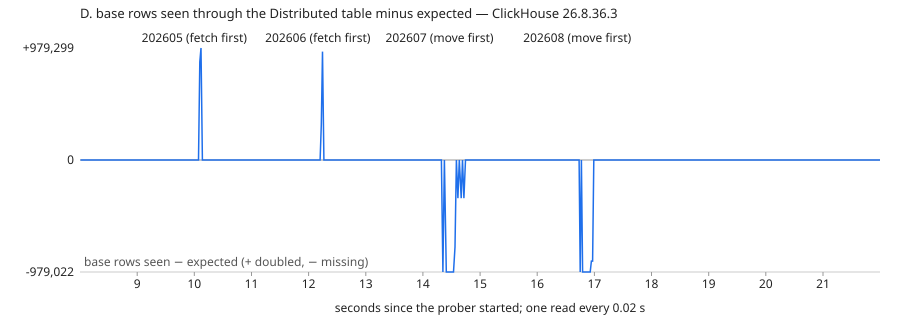

# Results — 26.8.36.3

Generated by `report.py` from `results/26.8.36.3.json` (run `python3 run.py all`, 2026-11-07). Every number is from that run.

ClickHouse 26.8.36.3 (server and Keeper), 12,000,000 rows on 2 shards × 2 replicas, then shard 3 (2 replicas). Docker VM: 12 CPU, 8319172608 B; servers capped at 2 CPUs and 900 MiB (`ch-s1r1`, which runs the copies, 1,400 MiB), Keeper 512 MiB / 1 CPU.

Other containers running on the same Docker VM when the run started (`docker stats --no-stream`):

- none

## Selftest: the per-partition check

| injected | result |
|---|---|
| none | PASS |
| one row inserted twice | FAIL — 202606: expected [1894737, 1894737] got [1894738, 1894737] |
| that row deleted (both copies) | FAIL — 202606: expected [1894737, 1894737] got [1894736, 1894736] |
| one `amount` changed, same count | count equal True, row hash equal False |

## Rows per shard (shard 1 / 2 / 3)

| option | before | after |
|---|---|---|
| A. weights 1:1:2, then 3,000,000 new rows | 6,002,487 / 5,997,513 / 0 | 6,755,667 / 6,745,787 / 1,500,946 |
| B. `INSERT … SELECT` from `remote()` into a new 3-shard table | 6,002,487 / 5,997,513 / 0 | 4,017,368 / 3,973,248 / 4,014,084 |
| D. 4 partitions moved to shard 3 | 6,002,487 / 5,997,513 / 0 | 4,077,796 / 4,041,946 / 3,884,658 |

## A. New shard + weights

- `clusters.xml` rewritten on the host, no `SYSTEM RELOAD CONFIG`: every server showed shard 3 after 0.92–1.14 s (ch-s1r1 0.92, ch-s1r2 1.14, ch-s2r1 0.93, ch-s2r2 0.93, ch-s3r1 0.93, ch-s3r2 0.94).
- 3,000,000 new rows with weights 1:1:2 went 751,983 / 747,167 / 1,500,850 (insert 0.69 s).
- Point lookups `WHERE user_id = …` with `optimize_skip_unused_shards = 1` (and `force_…`), 200 users: before 0 differ; after 97 differ, 5,849 rows not returned.
- Check of the original rows: PASS; new rows: PASS.

| window | reads | read errors | read ms p50 / p95 / max | reads doubled / missing | writes | write errors | write ms p50 / p95 / max |
|---|---|---|---|---|---|---|---|
| 10 s before | 49 | 0 | 27.2 / 37.8 / 40.7 | 0 / 0 | 39 | 0 | 25.9 / 73.4 / 82.2 |
| config change | 6 | 0 | 22.5 / 27.0 / 27.0 | 0 / 0 | 5 | 0 | 28.6 / 90.4 / 90.4 |
| whole run | 60 | 0 | 26.7 / 37.8 / 41.6 | 0 / 0 | 48 | 0 | 26.4 / 82.2 / 90.4 |

## B. `INSERT … SELECT` from `remote()`

| partition | rows | seconds | rows/s |
|---|---|---|---|
| 202605 | 1,957,895 | 0.4 | 4,894,737 |
| 202606 | 1,894,737 | 0.55 | 3,444,976 |
| 202607 | 1,957,895 | 0.42 | 4,661,654 |
| 202608 | 1,957,895 | 0.4 | 4,894,737 |
| 202609 | 1,894,736 | 0.4 | 4,736,840 |
| 202610 | 1,957,895 | 0.43 | 4,553,244 |

- Bulk copy 2.6 s for 11,621,053 rows.
- Check before the cut-over: FAIL — 202611: expected [378947, 378947] got None; probe 0/2,700 acked rows present.
- Cut-over: writes paused, hot partition 202611 (378,947 base rows + probe rows) copied in 0.17 s, reads and writes switched; writes frozen 0.31 s.
- Check after: PASS.
- Point lookups with `optimize_skip_unused_shards = 1` on the new table: 0/200 differ.
- Replicas: ch-s1r1 4,017,368, ch-s1r2 4,017,368, ch-s2r1 3,973,248, ch-s2r2 3,973,248, ch-s3r1 4,014,084, ch-s3r2 4,014,084.

| window | reads | read errors | read ms p50 / p95 / max | reads doubled / missing | writes | write errors | write ms p50 / p95 / max |
|---|---|---|---|---|---|---|---|
| 10 s before | 49 | 0 | 25.7 / 36.5 / 52.0 | 0 / 0 | 39 | 0 | 25.2 / 82.4 / 87.3 |
| bulk copy | 12 | 0 | 28.6 / 45.1 / 49.2 | 0 / 0 | 10 | 0 | 17.4 / 40.9 / 40.9 |
| whole run | 118 | 0 | 23.5 / 36.5 / 52.0 | 0 / 0 | 94 | 0 | 24.7 / 78.8 / 87.3 |

Fault injection on the result (event_id in 202607):

| step | check |
|---|---|
| row inserted again | FAIL — 202607: expected [1957895, 1957895] got [1957896, 1957895] |
| row deleted (both copies) | FAIL — 202607: expected [1957895, 1957895] got [1957894, 1957894] |
| row copied once from the old table | PASS |

## D. Partition relocation

Shard 3 joined cluster `old` with weight 0 (reads go to it, hashed writes do not: probe rows by shard 2,242 / 2,158 / 0).

| partition | from | variant | step times (s) | exposed (s) |
|---|---|---|---|---|
| 202605 | shard 1 | fetch-first | fetch 0.05, attach 0.05, drop 0.05 | 0.1 |
| 202606 | shard 1 | fetch-first | fetch 0.03, attach 0.05, drop 0.05 | 0.1 |
| 202607 | shard 2 | move-first | move 0.16, fetch 0.09, attach 0.04 | 0.3 |
| 202608 | shard 2 | move-first | move 0.12, fetch 0.07, attach 0.08 | 0.27 |

Reads every 0.02 s through the Distributed table, runs of reads whose base count was off:

- 10.1–10.12 s: doubled, up to 979,299 rows
- 12.22–12.24 s: doubled, up to 947,634 rows
- 14.35–14.35 s: missing, up to 978,703 rows
- 14.41–14.56 s: missing, up to 978,703 rows
- 14.61–14.61 s: missing, up to 333,879 rows
- 14.67–14.67 s: missing, up to 333,879 rows
- 14.72–14.72 s: missing, up to 333,879 rows
- 16.75–16.75 s: missing, up to 979,022 rows
- 16.79–16.97 s: missing, up to 979,022 rows

- Check: PASS.
- Point lookups with `optimize_skip_unused_shards = 1`: before 0/200 differ, after 200/200 differ, 3,876 rows not returned.
- Replicas: ch-s1r1 4,077,796, ch-s1r2 4,077,796, ch-s2r1 4,041,946, ch-s2r2 4,041,946, ch-s3r1 3,884,658, ch-s3r2 3,884,658.

| window | reads | read errors | read ms p50 / p95 / max | reads doubled / missing | writes | write errors | write ms p50 / p95 / max |
|---|---|---|---|---|---|---|---|
| 10 s before | 459 | 0 | 19.7 / 27.5 / 70.7 | 0 / 0 | 39 | 0 | 21.3 / 76.0 / 103.2 |
| whole run | 1014 | 0 | 19.4 / 27.5 / 70.7 | 4 / 19 | 88 | 0 | 21.7 / 120.7 / 124.0 |



## Failure: source replica killed during a `remote()` copy

`docker kill rs-ch-s2r2` once the copy had read 50% of the partition. The copy read replica 2 first (`'r2|r1'`, `load_balancing = in_order`) and wrote through the new Distributed table to replica 1. Copies and retries were throttled with `max_network_bandwidth = 2000000` (unthrottled, a partition took about 0.4 s); the recovery copy after `DROP PARTITION` was not.

### partition 202605 (1,957,895 rows), `insert_deduplication_token` = none, default block size and receive_timeout

- Killed at read_rows 980,023, written_rows 1,234,465; copy error: `Code: 209. DB::Exception: Timeout exceeded while reading from socket (ch-s2r2:9000, receive timeout 300000 ms): While executing Remote. (SOCKET_TIMEOUT) (version 26.8.36.3 (official build))`.
- Left in the new table: 0 rows (0 distinct) of 1,957,895; check FAIL — 202605: expected [1957895, 1957895] got None.
- Retry without dropping, replica still down: 25.58 s; check PASS.
- Replica back after 1.02 s; `DROP PARTITION` + copy 0.46 s; check PASS.

### partition 202606 (1,894,737 rows), `insert_deduplication_token` = none, `min_insert_block_size_rows = 100000`, `max_insert_block_size = 100000`, `receive_timeout = 30`

- Killed at read_rows 949,406, written_rows 1,174,413; copy error: `Code: 209. DB::Exception: Timeout exceeded while reading from socket (ch-s2r2:9000, receive timeout 30000 ms): While executing Remote. (SOCKET_TIMEOUT) (version 26.8.36.3 (official build))`.
- Left in the new table: 968,497 rows (968,497 distinct) of 1,894,737; check FAIL — 202606: expected [1894737, 1894737] got [968497, 968497].
- Retry without dropping, replica still down: 24.59 s; check FAIL — 202606: expected [1894737, 1894737] got [2863234, 1894737].
- Replica back after 1.02 s; `DROP PARTITION` + copy 0.41 s; check PASS.

### partition 202607 (1,957,895 rows), `insert_deduplication_token` = reshard-202607, `min_insert_block_size_rows = 100000`, `max_insert_block_size = 100000`, `receive_timeout = 30`

- Killed at read_rows 981,947, written_rows 1,217,532; copy error: `Code: 209. DB::Exception: Timeout exceeded while reading from socket (ch-s2r2:9000, receive timeout 30000 ms): While executing Remote. (SOCKET_TIMEOUT) (version 26.8.36.3 (official build))`.
- Left in the new table: 973,316 rows (973,316 distinct) of 1,957,895; check FAIL — 202607: expected [1957895, 1957895] got [973316, 973316].
- Retry without dropping, replica still down: 25.38 s; check FAIL — 202607: expected [1957895, 1957895] got [2159171, 1952523].
- Replica back after 1.02 s; `DROP PARTITION` + copy 0.44 s; check PASS.

| window | reads | read errors | read ms p50 / p95 / max | reads doubled / missing | writes | write errors | write ms p50 / p95 / max |
|---|---|---|---|---|---|---|---|
| 10 s before | 24 | 0 | 27.8 / 37.5 / 44.5 | 0 / 0 | 19 | 0 | 24.1 / 79.6 / 80.3 |
| both failures | 2390 | 0 | 25.4 / 37.0 / 160.7 | 0 / 0 | 1908 | 0 | 23.3 / 47.8 / 1034.0 |

Probe writes to the old table during the failures: 96,400/96,400 acknowledged rows present, 0 doubled; 0 batches failed (0 of their rows present).

Error text of the first failed copy:

```text
Code: 209. DB::Exception: Timeout exceeded while reading from socket (ch-s2r2:9000, receive timeout 300000 ms): While executing Remote. (SOCKET_TIMEOUT) (version 26.8.36.3 (official build))
```
